<div align="center">

# cloudctl

**One CLI for AWS, Azure, and GCP — with an AI agent that actually investigates, and fixes what it finds.**

*AI investigation & remediation: AWS today — Azure/GCP on the roadmap.*

[](https://pypi.org/project/cctl/)
[](https://pypi.org/project/cctl/)
[](https://github.com/cloudctlio/cloudctl/actions/workflows/security.yml)
[](LICENSE)

<br/>



<br/>

```bash
pip install "cctl[ai]"
```

</div>

---

## Why cloudctl?

Most cloud CLIs are thin wrappers around vendor APIs. cloudctl is different in one key way: **`cloudctl debug`** runs a real investigation.

Instead of returning raw API data and leaving diagnosis to you, it measures the symptom, investigates several competing explanations in parallel against your real logs, metrics, config, and audit trail, and cross-examines the findings before surfacing a single answer with calibrated confidence and IaC-aware fix steps. A hypothesis that isn't supported by evidence doesn't ship — when nothing is proven, it says so instead of guessing.

With `--resolve` it goes one step further: it writes the minimal IaC fix on a branch, validates it, and opens a PR — pausing for your approval before any file is touched and again before anything is pushed.

```
cloudctl debug --agent "payments service returning 502s since 3pm"
```

No log-grepping. No tab-switching. One command.

---

## Install

Requires **Python 3.13+**.

```bash
# Core CLI — all three clouds, no AI
pip install cctl

# With AI debug + ask (recommended)
pip install "cctl[ai]"

# With MCP server for Claude Desktop / Cursor
pip install "cctl[mcp]"

# Everything
pip install "cctl[all]"
```

---

## Quick Start

```bash
# Auto-detects your existing AWS/Azure/GCP credentials — no prompts
cloudctl init

# Query all clouds at once
cloudctl compute list --cloud all
cloudctl cost summary --cloud all
cloudctl security audit --cloud all

# Target a specific account
cloudctl database list --account prod --cloud aws

# Diagnose an incident with the AI agent
cloudctl debug --agent "ECS service unhealthy after last deploy"
```

---

## cloudctl debug

The flagship command. Give it a symptom — it fetches real data, runs parallel hypothesis branches, and returns a root cause with steps tailored to how you deployed.

### How the agent works

```
symptom
  │
  ▼
measure ──── quantifies the symptom in real data: when did it start,
  │          what exactly is affected, what is demonstrably fine
  ▼
investigate ─ several competing explanations pursued in parallel against
  │           live logs, metrics, configuration, and audit trail
  ▼
cross-examine ─ findings are challenged before anything is concluded;
  │             unsupported explanations are discarded
  ▼
root cause + calibrated confidence + IaC-aware fix steps
  │
  ▼
verdict prompt — was this correct? (feeds the live learning loop)
  │
  ▼ (--resolve)
resolution agent — writes the minimal IaC fix on a branch, validates,
                   opens a PR — gated by two operator approvals:
                   ① the fix plan (what changes, where) before any write
                   ② the real diff + passing validation before any push
```

The agent checks **configuration state first** (the same order a human SRE would), then operational state. Confidence is earned, not asserted: an answer only ships with high confidence when the evidence directly supports it, and when nothing is proven the agent says "not proven" instead of telling a plausible-sounding story.

### Deep service analysis, any service

The agent isn't limited to pre-built integrations. Alongside dedicated tools (logs, metrics, CloudTrail, config, deployment detection) it can safely explore any AWS service's read-only APIs — writes are blocked — so it can go deep on services it has never seen, test IAM permissions deterministically via the policy simulator, and map your deployment's real dependency topology from live configuration.

### Deployment detection

cloudctl identifies how a resource is managed and tailors fix steps to your tooling:

| Detected via | Tooling |
|---|---|
| CloudFormation stack membership | CDK, CloudFormation |
| Terraform state tags | Terraform, OpenTofu |
| CloudTrail `CreateChangeSet` events | CloudFormation |
| CloudTrail user-agent analysis | Terraform, CDK, console/manual |

Azure (ARM/Bicep) and GCP (Deployment Manager) detection land together with agent support for those clouds.

### Gets smarter over time

Every confirmed diagnosis is stored locally. On repeat incidents, cloudctl pattern-matches against past confirmed fixes and can promote confidence automatically — so the third time you diagnose the same class of misconfiguration, it converges faster.

```bash
# Confirm a diagnosis was correct — stored for future pattern matching
cloudctl debug --agent --verdict y "ECS tasks crashing after deploy"

# Pass verdict non-interactively in scripts / run loops
cloudctl debug --agent --verdict skip "..."
```

---

## Commands

### Infrastructure

| Command | What it does |
|---|---|
| `cloudctl compute list/describe/stop/start` | VMs, Lambda, Cloud Run, ECS, GKE (`stop`/`start` change real instances) |
| `cloudctl storage list/describe/ls/du` | S3, Blob Storage, GCS |
| `cloudctl database list/describe/snapshots` | RDS, Azure SQL, Cloud SQL |
| `cloudctl network vpcs/security-groups/lb` | VPCs, NSGs, load balancers, DNS |
| `cloudctl containers list/describe` | ECS, AKS, GKE, ECR, ACR |
| `cloudctl iam roles/users/check` | IAM roles, users, permission checks |
| `cloudctl security audit/public-resources` | Security posture and misconfigs. `audit --fix` changes the cloud directly, through the policy gate, see below |
| `cloudctl cost summary/by-service` | Cost breakdown across clouds. `by-service --fix` changes the cloud directly, through the policy gate, see below |
| `cloudctl pipeline list/analyze` | CodePipeline, Azure DevOps, Cloud Build |
| `cloudctl monitoring alerts/metrics` | CloudWatch, Azure Monitor, GCP Monitoring |
| `cloudctl messaging topics/queues` | SQS/SNS, Service Bus, Pub/Sub |
| `cloudctl backup list/status` | Backup jobs across clouds |
| `cloudctl find <query>` | Search resources by name, tag, or type |
| `cloudctl diff` | Compare which resources exist in two accounts or regions (does not read IaC or detect drift) |

### AI (requires `pip install "cctl[ai]"`)

| Command | What it does |
|---|---|
| `cloudctl debug "<symptom>"` | Parallel hypothesis investigation → root cause + fix |
| `cloudctl debug --agent "<symptom>"` | Full agentic mode: triage → investigate → synthesize → critique |
| `cloudctl debug --agent --verdict y/n "<symptom>"` | Diagnose and record whether the answer was correct (trains the learning loop) |
| `cloudctl debug --agent --json-out result.json "<symptom>"` | Save structured JSON output alongside the rendered result |
| `cloudctl debug --agent --resolve --iac-root <dir> "<symptom>"` | After a confirmed diagnosis: write the minimal IaC fix on a branch, validate, open a PR — with two operator approval gates (fix plan; diff + validation), and the push goes through the [policy gate](docs/policy-gate.md) |
| `cloudctl debug ... --resolve --yes` | Skip the operator prompts (CI use). The policy gate still runs. Non-interactive runs without `--yes` stop safely at the first gate |
| `cloudctl debug ... --resolve --env <name> --approval <id>` | Pick the gate environment, and pass a signed approval for a large prod change |
| `cloudctl ask "<question>"` | Answer cloud questions from live data |
| `cloudctl ask --interactive` | Multi-turn chat, context preserved |
| `cloudctl feedback list/accuracy` | Review AI answer history and accuracy |

### Policy gate (requires `pip install "cctl[gate]"`)

Every `--fix` and `--resolve` change goes through a five-stage gate: short-lived scoped credentials, the platform's own plan, policy engines (OPA/Rego, Checkov, Trivy, cfn-guard, Kyverno, Infracost, AWS/Azure/GCP native guardrails), signed approval for large prod changes, then a one-time authorization. Everything is written to a hash-chained audit log. See [docs/policy-gate.md](docs/policy-gate.md).

| Command | What it does |
|---|---|
| `cloudctl gate init --cloud aws\|azure\|gcp ...` | Write a starter control-plane config |
| `cloudctl gate validate` | Check the config, including the production rules |
| `cloudctl gate engines` | Which engines are on, pinned and installed |
| `cloudctl gate policy eval plan.json --env <name>` | Run the engines on a Terraform plan JSON (exit 2 on HIGH/CRITICAL) |
| `cloudctl gate keygen --approver <name>` | Make an approver's Ed25519 key |
| `cloudctl gate approvals list` / `cloudctl gate approve <id>` | Review and sign approval requests |
| `cloudctl gate sign req.json --approver <name>` | Sign a request fetched from the control-plane service, offline |
| `cloudctl gate audit verify` | Check the audit hash chain |

### Change requests (requires `pip install "cctl[gate]"`)

Compile a plain-language request into a change graph (validated against a fixed schema; ambiguous requests get questions back), then run it node by node through the policy gate. A failed node is never retried: everything after it is skipped and a targeted rollback request is queued. See [docs/control-plane.md](docs/control-plane.md).

| Command | What it does |
|---|---|
| `cloudctl change compile "<request>" -o graph.json` | Ask the model for a change graph; applies nothing |
| `cloudctl change run graph.json` | Run the graph through the gate, in dependency order |
| `cloudctl change resume <run> --approval <node>=<id>` | Carry on after approvals |
| `cloudctl change status <run>` / `cloudctl change list` | Where runs stand |
| `cloudctl change rollbacks` | Rollback requests waiting for the drift repair loop |

### Drift repair loop (requires `pip install "cctl[gate]"`)

Find where live state no longer matches IaC (Terraform/OpenTofu, Pulumi, ARM/Bicep, Kubernetes, CloudFormation/CDK on AWS, Azure and GCP), and repair it only through the gate, within an autonomy table: class first (a security incident is never auto-repaired), then environment tier × severity, then confidence θ. See [docs/drift-loop.md](docs/drift-loop.md).

| Command | What it does |
|---|---|
| `cloudctl drift scan [--no-repair]` | One pass over every IaC root |
| `cloudctl drift loop --interval 900` | Keep scanning; also takes rollback requests |
| `cloudctl drift list` / `cloudctl drift show <event>` | Drift events, with class, severity, confidence and decision |
| `cloudctl drift repair <event> [--override "why"]` | A person's go-ahead to repair one event |
| `cloudctl drift table` | The autonomy table in force |

### Control-plane service (requires `pip install "cctl[service]"`)

Run the gate, change runs and the drift loop as an HTTP API for a team: OIDC sign-in with roles, approvals signed offline, shared state on DynamoDB, Cosmos DB or Firestore, immutable audit on S3, Azure Storage or GCS, and a container, Helm chart, Terraform and an OIDC deploy workflow for EKS, AKS and GKE. See [docs/service.md](docs/service.md).

| Command | What it does |
|---|---|
| `cloudctl serve --config service.yaml` | Run the API (127.0.0.1:8080 by default) |

### Setup

| Command | What it does |
|---|---|
| `cloudctl init` | Auto-detect credentials, enable all found clouds |
| `cloudctl accounts list/verify/use` | Manage cloud accounts and profiles |
| `cloudctl config get/set/list` | Manage cloudctl configuration |

---

## MCP Server

Works with Claude Desktop, Cursor, and any MCP-compatible client.

```bash
pip install "cctl[mcp]"
cloudctl mcp config    # prints config block for claude_desktop_config.json
cloudctl-mcp           # start the server
```

Once connected, your AI client can query your cloud directly:

> *"What's prod's cost breakdown this month?"*
> *"List all ECS services with CPU > 80%"*
> *"Show me recent pipeline failures"*

---

## How It Works

- **No new auth** — reads `~/.aws/config`, `~/.azure/`, `~/.config/gcloud/` as-is
- **Auto output format** — Rich tables in terminal, clean JSON when piped (`| jq`)
- **Multi-account** — `--account prod` fuzzy-matches any profile name or account ID
- **Multi-cloud** — `--cloud all` queries AWS + Azure + GCP in parallel
- **AI is optional** — all CLI commands work without `cctl[ai]`; only `debug` and `ask` need it
- **Read-only by default** — `cloudctl debug` and its agent cannot mutate anything; `--resolve` writes only to your local IaC repo and git, behind operator approvals
- **Commands that change your cloud directly** — `compute stop/start`, the MCP `stop_compute`/`start_compute` tools (dry run unless `dry_run=false`), and `--fix` on `cost by-service` and `security audit`. After a per-item confirmation and a pass through the [policy gate](docs/policy-gate.md), `--fix` calls the cloud API itself with the gate's short-lived credentials: it can stop EC2 instances, **delete** EBS volumes and snapshots, revoke security-group rules, turn on S3 public-access blocks and deactivate IAM access keys (and the Azure/GCP equivalents). `compute stop/start` and the MCP tools do not go through the gate yet. These changes are not made through your IaC, so the next `terraform apply` / `cdk deploy` may revert them or show drift
- **Secrets stay out of context** — secret material is scrubbed from tool output before the model or your terminal sees it
- **Crash-safe investigations** — an investigation killed mid-flight (expired credentials, Ctrl-C) resumes from its last completed step instead of starting over

---

## Cloud Support

| | AWS | Azure | GCP |
|---|:---:|:---:|:---:|
| CLI commands | ✅ Tested | ⚠️ Implemented, untested | ⚠️ Implemented, untested |
| MCP server | ✅ Tested | ⚠️ Implemented, untested | ⚠️ Implemented, untested |
| AI debug (`cloudctl debug`) | ✅ Full | 🚧 Roadmap | 🚧 Roadmap |
| AI resolution (`--resolve`) | ✅ Full | 🚧 Roadmap | 🚧 Roadmap |

AWS is the validated path today — the AI agent is exercised against live fault-injection environments. Azure/GCP provider code exists for the CLI/MCP layer but hasn't been validated against real subscriptions/projects yet; treat it as experimental. The investigation architecture itself (measure → predict → test → veto) contains no AWS-specific reasoning — Azure/GCP agent support is a matter of porting the tool layer (log/metric/config/audit fetchers), not the agent.

---

## AI Provider Support

`cloudctl debug` and `cloudctl ask` work with any Claude deployment:

| Provider | Config |
|---|---|
| AWS Bedrock (Claude) | `cloudctl config set ai.provider bedrock` |
| Anthropic API | `cloudctl config set ai.provider anthropic` |
| Azure AI Foundry | `cloudctl config set ai.provider azure_foundry` |
| Google Vertex AI | `cloudctl config set ai.provider vertex` |

```bash
cloudctl config set ai.provider bedrock
cloudctl config set ai.model anthropic.claude-sonnet-4-6-v1
```

---

## Credentials

cloudctl never stores credentials. It reads what you already have:

```bash
aws configure --profile prod        # AWS
az login                            # Azure
gcloud auth application-default login  # GCP
```

---

## Known Limitations

- **CloudTrail lag** — AWS management events take up to 15 minutes to appear. If you run `cloudctl debug` immediately after a config change, the triggering event may not be visible yet.
- **ALB access logs** — Log analysis requires `access_logs.s3.enabled = true` on the load balancer. Falls back to CloudWatch metrics otherwise.
- **CloudWatch Logs retention** — Searches the last 3 hours by default. Log groups with shorter retention will return no results.
- **Cross-account resources** — Operates within a single AWS account per run. Cross-account resources require separate `--account` invocations.
- **IaC detection requires audit trail** — Terraform/CDK/CloudFormation detection relies on CloudTrail. If CloudTrail is off or events have aged out, deployment method shows as `unknown`.

---

## Links

- **PyPI:** https://pypi.org/project/cctl/
- **Issues:** https://github.com/cloudctlio/cloudctl/issues
- **License:** MIT
